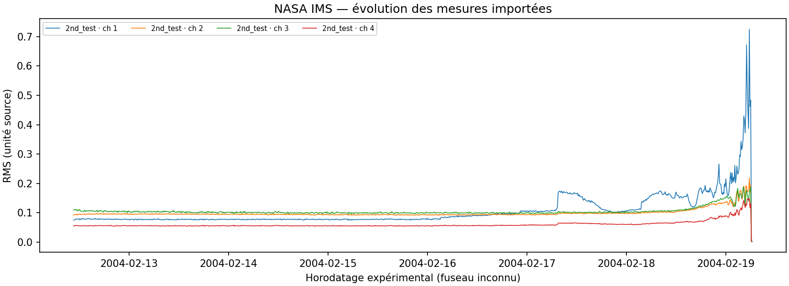

# PredictMaint AI

Plateforme locale de maintenance prédictive des machines tournantes. **Données NASA IMS réelles dès le pipeline d’entrée**, rejeu chronologique, détecteurs entraînés, supervision React, alertes et interventions persistées dans SQLite. Aucun Docker nécessaire.

Cette version est un prototype de recherche et de démonstration. Elle fournit des scores d’anomalie, sans probabilité de panne ni prétention de validation industrielle.

## Démarrage sur ce poste Windows

L’environnement Python 3.12, les dépendances, l’essai NASA 2 et les modèles ont été préparés dans ce dossier.

**Un seul double-clic : `Lancer PredictMaint.cmd`**, à la racine du projet, ou le raccourci **Lancer PredictMaint** sur le Bureau. Le lanceur démarre les deux serveurs en arrière-plan, attend qu’ils répondent et ouvre le navigateur. Sa fenêtre se ferme une fois l’application prête. Un nouveau double-clic réutilise les serveurs déjà disponibles.

Pour arrêter les serveurs lancés ainsi, utiliser **`Arreter PredictMaint.cmd`** ou le raccourci **Arreter PredictMaint**. Fermer le navigateur ne les arrête pas. Les journaux sont dans `.cache/launcher/logs/` ; une erreur garde la fenêtre ouverte avec un message.

Pour recréer les raccourcis après déplacement du projet :

```powershell
powershell.exe -NoProfile -ExecutionPolicy Bypass -File .\scripts\install-shortcuts.ps1
```

Le lancement manuel reste disponible avec deux terminaux :

```powershell
# Terminal 1
.\scripts\start-backend.cmd
```

```powershell
# Terminal 2
.\scripts\start-frontend.cmd
```

Ouvrir **http://localhost:5173**. Documentation interactive : **http://localhost:8000/docs**. Les serveurs écoutent uniquement sur la boucle locale.

Sur une nouvelle installation : exécuter d’abord `scripts\setup.cmd`. Voir [installation](docs/installation.md) pour Python, Linux/macOS et les cas sans uv.

## Première démonstration

1. Mode **NASA Replay**, essai `2nd_test`, canal 1, vitesse ×60.
2. Choisir **Fin · 30 derniers fichiers** pour examiner rapidement la dégradation historique documentée ; ce choix est un déplacement explicite dans l’historique.
3. Démarrer. Un fichier apparaît immédiatement, puis un toutes les dix secondes pour cet essai à ×60. Consulter la fiche équipement et l’analyse FFT.
4. Les scores viennent du modèle du canal. Une anomalie persistante génère une alerte ; acquitter, puis créer une intervention.
5. Arrêter le rejeu, passer en **Simulation**, démarrer les 20 équipements et sélectionner une machine.
6. Choisir le scénario **Dégradation progressive**. L’alerte résulte de mesures synthétiques ; la provenance reste visible.
7. Consulter modèles, alertes et interventions. Redémarrer le backend pour vérifier la persistance.

Démonstration automatique, backend lancé : `.venv\Scripts\python.exe -m scripts.demo`. Le script crée des données et une intervention clairement identifiées comme démonstration. [Procédure détaillée](docs/demo.md).

## Données réellement préparées

- Archive IMS obtenue le 7 novembre 2026 depuis le miroir PHM Society référencé par NASA, **1 075 597 174 octets**.
- Essai 2 complet : **984 fichiers ASCII**, quatre canaux, **3 936 observations fichier/canal**.
- Acquisition du **12/02/2004 10:32:39** au **19/02/2004 06:22:39**, intervalle constaté de **600 s**.
- 20 480 échantillons par canal ; fréquence documentée 20 kHz, soit 1,024 seconde par fichier.
- Essais 1 et 3 conservés compressés dans l’archive ; leur import est pris en charge, leur exploitation n’a pas été validée ici.
- Aucun signal brut ni modèle binaire dans Git. Les fichiers locaux restent dans `data/` et `artifacts/`.

[Registre JSON](data/dataset_registry.json), [conditions et import manuel](docs/datasets.md), [inventaire vérifié](docs/reports/nasa_inventory.json), [empreintes](docs/reports/nasa_download.json).



## Reproduire le pipeline NASA

Depuis la racine, avec Python 3.12 et les dépendances installées :

```powershell
.venv\Scripts\python.exe -m scripts.download_nasa --source phm --extract
.venv\Scripts\python.exe -m scripts.import_nasa --trial 2nd_test
.venv\Scripts\python.exe -m scripts.explore_nasa
.venv\Scripts\python.exe -m scripts.train
.venv\Scripts\python.exe -m scripts.train_simulation
.venv\Scripts\python.exe -m scripts.train_ai4i --download
.venv\Scripts\python.exe -m scripts.init_db
```

Le premier téléchargement est volumineux et les archives sont imbriquées ZIP → 7z → RAR. Sous Windows, le bsdtar présent sur ce poste extrait le RAR ; sinon extraction manuelle avec un outil déjà disponible. Le script n’installe aucun logiciel système.

## Fonctionnalités

- FastAPI REST/OpenAPI, WebSocket avec reconnexion et files bornées ; validation Pydantic.
- SQLite, SQLAlchemy, migration Alembic, index temporels et clés étrangères.
- Rejeu NASA : essai/canal, position initiale, démarrer, pause, reprendre, arrêter, réinitialiser, ×1/×10/×60.
- Signal temporel, FFT, RMS, moments, kurtosis, crest factor, bandes, comparaison de mesures et export CSV.
- Baseline robuste MAD et Isolation Forest par canal, séparation chronologique, artefacts et métriques traçables.
- Simulation distincte à graine fixée, jusqu’à 20 machines et neuf scénarios ; détecteur synthétique séparé.
- Alertes persistantes, temporisation par observations consécutives, hystérésis, déduplication, délai anti-spam, absence de mesures, acquittement/résolution.
- Interventions : création, planification, priorité, statut, commentaires et historique.
- Interface française, thèmes sombre/clair, responsive, provenance explicite, son activable.

## Vérification

```powershell
.venv\Scripts\python.exe -m pytest -q
.venv\Scripts\python.exe -m ruff check backend ml simulation scripts
.venv\Scripts\python.exe -m mypy backend/app ml simulation scripts --no-incremental
cd frontend
npm.cmd test
npm.cmd run build
# Les deux serveurs doivent fonctionner ; Edge installé pour la configuration actuelle.
npm.cmd run e2e
```

Les tests Python utilisent un répertoire temporaire dans `.cache/`. Les fixtures artificielles de format NASA restent exclusivement dans les tests ; elles ne sont jamais livrées comme mesures expérimentales. [Compte rendu par phase](docs/phases.md).

## Limites assumées

Le début de chaque essai est une référence supposée nominale, pas une certification d’absence de défaut. Les scores sont très sensibles à la dérive des conditions. Sans étiquettes par fichier, précision, rappel, F1, PR-AUC, faux positifs et délai réel de détection ne sont pas calculables honnêtement. Aucun indice de santé arbitraire n’est affiché.

AI4I est importé et son Random Forest calibré est évalué séparément : F1 0,67647, PR-AUC 0,67071, Brier 0,00982 sur 2 000 lignes synthétiques de test. Il classe une panne présente, sans horizon futur. Paderborn reste non importé ; sa classification de défauts est une extension conditionnée à l’obtention et la validation du lot. MLflow et XGBoost n’ont pas été ajoutés ; le registre local JSON/Joblib couvre le suivi nécessaire à cette version.

L’application n’a pas d’authentification et doit rester locale. Les réglages d’alertes et scénarios actifs sont conservés en mémoire ; les sessions, mesures, prédictions, alertes et interventions sont persistées. Les sessions interrompues restent dans l’historique et ne redémarrent pas automatiquement.

## Documentation

- [Installation et environnement](docs/installation.md)
- [Guide utilisateur](docs/user-guide.md)
- [Architecture et flux](docs/architecture.md)
- [API](docs/api.md)
- [Dictionnaire des données](docs/data-dictionary.md)
- [Modèles et évaluation](docs/ml-methodology.md)
- [Limites, sécurité et risques](docs/limitations.md)
- [Intégration en usine : MQTT, OPC UA, ERP, MES](docs/industrial-integration.md)
- [Résultats et commandes par phase](docs/phases.md)

Le dépôt est directement organisé à la racine du dossier fourni, sans sous-dossier redondant `predictmaint-ai/`.
