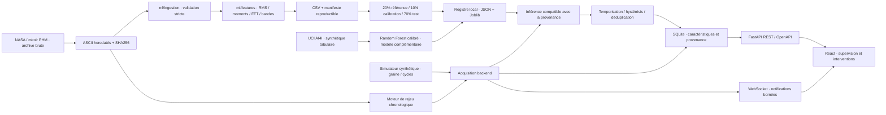

# Architecture technique

Monorepo directement à la racine du dossier fourni. La pile métier et scientifique est Python ; le frontend est un client de l’API et ne produit aucun indicateur industriel fictif.

## Modules

- `ml/ingestion/nasa.py` : découverte chronologique, mapping essai/canal/roulement, validation, empreintes.
- `ml/features/signal.py` : nettoyage explicite, fenêtres, moments, PSD/FFT et aperçu conservant les extrema.
- `ml/training/anomaly.py` : apprentissage, séparation, calibration du seuil, baseline et inférence.
- `simulation/industrial.py` : générateur pur et déterministe, indépendant du système de fichiers.
- `backend/app/models`, `database`, `schemas` : tables SQLAlchemy, sessions et commandes Pydantic.
- `backend/app/services` : moteur d’acquisition, alertes et registre des modèles.
- `backend/app/websocket` : une file bornée de 32 événements par connexion ; message resync si saturée.
- `backend/app/main.py` : routes, cycle de vie, CORS et branchement des services.
- `frontend/src/hooks` : chargement API, état de consultation et reconnexion WebSocket.
- `frontend/src/pages` : pages métier ; `components` : contrôles et visualisation partagés.
- `scripts` : installation, import, exploration, entraînement, migrations et démonstration.

Les fonctions de prétraitement/inférence/évaluation restent regroupées par domaine, au lieu d’ajouter des couches vides. Si les équipes ou modèles se multiplient, ces modules pourront devenir des packages distincts.

## Acquisition et temps

Le moteur rejoue une seule session active à la fois. Il charge un fichier complet côté serveur, calcule ses caractéristiques, prédit, persiste la transaction puis publie un événement. Les tâches CPU/IO s’exécutent via asyncio.to_thread ; le WebSocket ne transporte pas tous les échantillons bruts.

La première mesure est immédiate. La suivante attend la différence réelle des horodatages divisée par la vitesse choisie. Pause conserve l’attente restante ; un changement de vitesse la rééchelonne. Les trous temporels historiques sont conservés, sans plafond artificiel.

L’aperçu brut est chargé uniquement sur demande : au plus environ 512 points temporels et 512 points spectraux. Les extrema temporels et les pics spectraux sont conservés par blocs, sans prétendre remplacer les données brutes pour l’analyse scientifique.

## Persistance et redémarrage

SQLite utilise les clés étrangères, WAL et un délai d’attente de verrouillage. Mesure, caractéristiques, prédiction et alerte sont enregistrées dans la même transaction. Une contrainte unique empêche de réinsérer une acquisition de la même machine/session/horodatage.

Au démarrage, les sessions restées running/paused deviennent interrupted et les équipements sont arrêtés. Les données historiques ne sont pas supprimées. Les seuils modifiés, temporisations en cours et scénarios actifs restent en mémoire ; l’application ne reprend aucune commande automatiquement.

## Évolution

Un seul processus Uvicorn : le moteur et le broker sont en mémoire. Plusieurs workers nécessitent un scheduler externe, un verrou distribué et un broker Redis/NATS. Pour PostgreSQL, changer l’URL SQLAlchemy, ajouter son pilote et tester les migrations/contraintes/horodatages sur ce moteur. Cette migration future n’a pas été validée ici.

Les modèles Joblib sont des artefacts administrateur de confiance ; aucun upload de modèle utilisateur n’est accepté.
